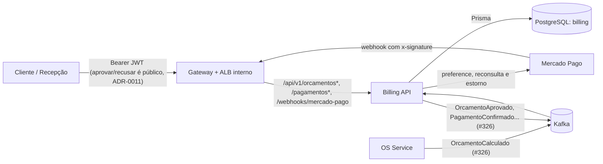

# repo-billing-service

Billing Service (Orçamento e Pagamento) do Tech Challenge Fase 4 (FIAP SOAT). Feature #323 do repositório `async-furious-project`, dentro do Epic #322.

Stack: NestJS 10, Prisma 5, PostgreSQL, Node 22, pnpm. Quatro camadas por módulo (`domain`, `application`, `infrastructure`, `presentation`) mais `shared/` (ADR-0006).

## Origem

Scaffold **copiado** do OS Service, pela mesma cópia já feita no `repo-execucao-service` (#319): sem fork, sem pacote npm compartilhado e sem submódulo git. Só foram ajustados nome do serviço, namespace (`billing`), banco e Swagger. O módulo `src/modules/financeiro/` é dono dos domínios `Orcamento` (migrado do `ordem-servico` por decisão do Epic #306) e `Pagamento` (extraído do `financeiro` do monolito), implantados na Feature #324. `ProcessedEvent` guarda a idempotência dos eventos Kafka por `eventId`.

## Domínio (Feature #324)

| Agregado | Ciclo de vida |
|---|---|
| `Orcamento` | `PENDING → APPROVED \| REJECTED` (enum `EstimateStatus`, o mesmo do monolito) |
| `Pagamento` | `AGUARDANDO_PAGAMENTO → CONFIRMADO \| RECUSADO \| CANCELADO`; `CONFIRMADO → ESTORNADO` (enum `StatusPagamento`) |

- **Totais vêm prontos do OS Service.** O `GerarOrcamentoHandler` monta o orçamento só com `valorTotalServicos`, `valorTotalPecas` e `valorTotalGeral` do evento `OrcamentoCalculado`, grava os três como vieram (sem recalcular nem conferir a soma) e não consulta `Peca`, `Servico`, `OsPeca` nem `OsServico`, nem chama o OS Service por REST. Um `OrcamentoCalculado` repetido com o orçamento ainda `PENDING` atualiza os totais; depois da aprovação ou recusa, é ignorado sem erro (ADR-0018).
- **Aprovação** (`PATCH /orcamentos/{ordemServicoId}/aprovar`): valida `PENDING` e reserva numa transação `Orcamento=APPROVED` + `Pagamento=AGUARDANDO_PAGAMENTO` sem cobrança (insert e update condicionais: só uma aprovação concorrente ganha). **Só o vencedor** cria a preference do Checkout Pro (um item agregado `OS {id}` com valor = `valorTotalGeral`, sem `payer`) e grava `preferenceId` e `linkPagamento`; então publica `OrcamentoAprovado` e devolve `{ linkPagamento }`. Assim o Mercado Pago recebe uma única preference por OS, mesmo em aprovações simultâneas. Quem perde a corrida não chama o Mercado Pago: recebe o link, se já gravado, ou 409 enquanto a cobrança está sendo gerada (tentar de novo depois). Aprovar de novo, depois de gravado, devolve o mesmo link sem republicar; aprovar depois de `REJECTED` é erro de domínio (400); falha do Mercado Pago devolve 502, desfaz a reserva (remove o `Pagamento` sem cobrança e volta o orçamento a `PENDING`) e nada fica gravado.
  - **Limite conhecido:** se o processo cair entre a reserva e a gravação do link, a OS fica `APPROVED` sem `linkPagamento` e as aprovações seguintes devolvem 409. Não há recuperação automática nesta versão; a correção (concessão de reserva expirada) é pendência a decidir pelo grupo.
- **Webhook do Mercado Pago** (`POST /webhooks/mercado-pago`, #325): o `MercadoPagoAssinaturaGuard` valida `x-signature`/`x-request-id` (HMAC, `WebhookSignatureValidator` do SDK, com o `data.id` da **query string**) antes de qualquer efeito; assinatura ausente ou inválida devolve 401. A notificação é só gatilho: o `ProcessarNotificacaoPagamentoUseCase` reconsulta `GET /v1/payments/{id}` e confere o valor com o do `Pagamento` (comparação em centavos, sem depender de erro de ponto flutuante). Mapeamento: `approved` → `CONFIRMADO` + `PagamentoConfirmado`; `rejected`/`cancelled` → `RECUSADO` + `PagamentoRecusado` (terminal; no Checkout Pro o comprador poderia tentar de novo, simplificação registrada na ADR-0022); `pending`/`in_process` → sem efeito e sem evento. Valor divergente não confirma e fica em log de erro. Falha na reconsulta devolve 502 e o Mercado Pago reenvia.
- **Idempotência de entrada**: `webhook_recebido` (`@@unique(providerEventId, tipo)`, com o id do pagamento no Mercado Pago e `payment.{status}`) é gravada **na mesma transação** que atualiza o `Pagamento` (`updateMany` condicionado ao status anterior); `Pagamento.mercadoPagoPaymentId` também é único. Reentrega, inclusive simultânea, devolve 200 sem novo efeito nem novo evento. Se o `Pagamento` mudou de estado no meio do processamento por outro motivo (ex.: a saga o cancelou), a notificação **não** é dada como processada: a resposta é 409, o Mercado Pago reenvia e a nova leitura segue o ramo certo (ex.: estorno do pagamento atrasado). Toda notificação precisa de assinatura válida, inclusive as que não alteram estado: sem `x-signature` (ou com assinatura inválida) recebe 401 antes de qualquer efeito. Uma notificação assinada que não altera estado (`merchant_order`, `type=payment` sem `data.id`) recebe 200 e é ignorada.
- **Estorno de `approved` indevido** (pagamento atrasado ou em duplicidade): se a reconsulta der `approved` e o `Pagamento` já não está `AGUARDANDO_PAGAMENTO`, o dinheiro não pertence a nenhuma cobrança aberta e é **estornado** (`POST /v1/payments/{id}/refunds`, total, com `X-Idempotency-Key` determinística `estorno-{id}`). Os casos são `CANCELADO` (pagamento atrasado: a saga fechou a OS antes de o cliente pagar, resultado `ESTORNADO_PAGAMENTO_ATRASADO`) e `RECUSADO`, `ESTORNADO` ou `CONFIRMADO` por **outro** id de pagamento (duplicidade, `ESTORNADO_PAGAMENTO_DUPLICADO`). Nunca publica `PagamentoConfirmado` e **não toca no `Pagamento`**: nem o status, nem o `mercadoPagoPaymentId` do pagamento original (a evidência do estorno é a linha em `webhook_recebido`, com o id do pagamento estornado). Idempotência: antes de estornar o Billing consulta `webhook_recebido`; uma reentrega depois do estorno registrado devolve 200 sem estornar de novo. O estorno vem antes do registro: se ele falhar, nada é gravado, a resposta é 502 e o Mercado Pago reenvia; se o registro falhar depois do estorno, o reenvio **não** estorna de novo quando a reconsulta já devolve `refunded` (status ignorado, 200, e nessa janela a linha em `webhook_recebido` nunca é gravada; `jaRecebida` só protege contra atraso de propagação do status no Mercado Pago). Se a reconsulta ainda devolver `approved`, o reenvio repete o estorno com a mesma chave de idempotência. O valor não é conferido nesse ramo (o dinheiro é devolvido por inteiro, seja qual for). Reentrega do `approved` que já confirmou o `Pagamento` (mesmo id) é só `JA_PROCESSADO`, nunca estorno.
- **Compensação da saga**: `CANCELADO` quando a saga falha antes do pagamento, `ESTORNADO` após o refund de um pagamento confirmado. A chamada de refund (`IGatewayPagamento.estornar`) existe; quem a aciona na compensação é o handler de `EtapaDaSagaFalhou` (#326). O estorno não gera evento de integração; a evidência é `Pagamento.status = ESTORNADO` mais o refund no painel do Mercado Pago.
- **Eventos**: por enquanto o publicador (`LogPublicadorEventos`) só registra `OrcamentoGerado`, `OrcamentoAprovado`, `OrcamentoRecusado`, `PagamentoConfirmado` e `PagamentoRecusado` em log, publicados depois do commit (sem outbox: se a publicação falhar depois do commit, a reentrega vira "já processado"). O produtor/consumidor Kafka entra na Feature de eventos (#326), trocando só o adapter da porta `IPublicadorEventos`.

## Visão do serviço e fatia de domínio



**Justificativa da fatia.** O Billing é dono do que muda de estado por causa do dinheiro: o `Orcamento` (migrado do OS Service pelo Epic #306) e o `Pagamento` (extraído do `financeiro` do monólito). Isso isola a integração com o Mercado Pago, as credenciais de cobrança e o ciclo de estorno do resto da OS. A fronteira é explícita: o Billing recebe os totais prontos do OS Service por evento e não consulta as tabelas dele; nenhuma FK cruza o banco. A comunicação é por eventos (coreografia), sem chamada REST para o OS Service.

**Swagger:** `/api/docs/billing` (JSON em `docs/openapi.json`, regenerado com `pnpm openapi:export`).

## Banco de dados

PostgreSQL, banco `billing`, role `billing_app` na instância RDS única, com `connection_limit=3` no `DATABASE_URL` (ADR-0020).

Tabelas: `orcamentos`, `pagamentos`, `webhook_recebido` (#325) e `processed_events`. **Nenhuma FK cruza a fronteira de serviço**: `Orcamento` e `Pagamento` referenciam a OS só por `ordemServicoId` (`@unique` nos dois). No monolito, `Orcamento` tinha FK para `OrdemServico` com `onDelete: Cascade`; ela foi removida porque a OS vive no banco do OS Service, e o Billing não pode ter constraint para lá. O fim de uma OS chega por evento, não por cascade: o orçamento e o pagamento ficam como registro auditável. O `@unique` em `Pagamento.ordemServicoId` garante uma cobrança por OS (um 2º pagamento da mesma OS viola a constraint e a aprovação concorrente perde).

**Migrations** versionadas em `prisma/migrations/`, aplicadas por `prisma migrate deploy` no `billing-migrate` (`k8s/migration-job.yaml`). O serviço começa vazio: não há ETL do monolito (decisão do Epic #306).

**Seed de demonstração** (`prisma/seed.mjs`, `pnpm db:seed`): cria um orçamento `PENDING` e um orçamento `APPROVED` com pagamento `AGUARDANDO_PAGAMENTO`, idempotente. Só roda com `DEPLOY_ENV=local` ou `hml` e recusa qualquer outro valor. Em HML, roda pelo `k8s/seed-job-hml.yaml` depois do `billing-migrate`; o manifesto não deve ser aplicado em produção. O secret `tc3-db-billing-<env>` é provisionado pelo `repo-db-infra` (Epic #312) e o banco/role são criados pelo `Job` de bootstrap do OS Service (#315), que também revoga o acesso do Billing aos bancos dos outros serviços. O serviço não acessa tabelas de outro serviço.

**Sem NoSQL.** O read model em DocumentDB fica no OS Service (#306); o Billing não depende de driver `mongodb`.

## Integração com o Mercado Pago (#325)

Só ambiente de teste (credenciais da aba **Teste** do painel, vendedor e comprador de teste); nenhuma credencial de produção. Decisões na [ADR-0022](https://github.com/Async-And-Furious/async-furious-project/blob/develop/docs/adr/0022-integracao-mercado-pago-checkout-pro.md).

| Variável | Onde fica | Uso |
|---|---|---|
| `MP_ACCESS_TOKEN` | `billing-secret` (ADR-0015) | cria a preference, reconsulta o pagamento e estorna |
| `MP_WEBHOOK_SECRET` | `billing-secret` (ADR-0015) | chave do HMAC do `x-signature` |
| `MP_NOTIFICATION_URL` | `billing-config` | URL pública do webhook, enviada como `notification_url` da preference |
| `MP_PREFERENCE_EXPIRACAO_HORAS` | `billing-config` | prazo da preference (`expires` + `expiration_date_to`), padrão **48** h |

Notas de operação:

- **Notificações sem assinatura são recusadas (efeito colateral).** O guard exige `x-signature` válida em toda notificação (#325). O IPN legado (`?id=&topic=`) não é assinado pelo Mercado Pago, e a própria documentação do IPN diz que ele será descontinuado: se o Mercado Pago ainda o enviar para este endpoint, a notificação recebe 401 e o Mercado Pago reenvia. Por isso a preference **não** pede `source_news=ipn`, e a conta deve usar Webhooks (padrão do painel, evento Pagamentos). Não adicionamos `source_news=webhooks` porque a documentação consultada não o confirma; o padrão do Checkout Pro já entrega por Webhooks. Confirmar no sandbox, antes da demonstração, que as notificações de pagamento chegam assinadas e que nenhum IPN nem `merchant_order` sem assinatura gera reenvios em série.
- **Qual chave assina.** Em 20/10/2026 só a notificação **simulada** pelo painel validou com a chave de Webhooks da aplicação principal; as notificações de pagamentos reais vieram assinadas com outra chave (hipótese: a da aplicação do vendedor de teste, dono das preferences). `MP_WEBHOOK_SECRET` precisa ser a chave que assina as notificações **reais**; sintoma de chave errada: 401 em toda notificação (`SignatureMismatch` no log do guard) e `Pagamento` parado em `AGUARDANDO_PAGAMENTO`.
- **Teste local.** Exponha a API com um túnel (ex.: `cloudflared tunnel --url http://localhost:3000`), cadastre `https://<túnel>/api/v1/webhooks/mercado-pago` como `MP_NOTIFICATION_URL` e/ou no painel (evento Pagamentos), aprove uma OS e pague o link com o comprador de teste (janela anônima; com a conta real logada o checkout falha). A assinatura é conferida contra `x-signature`, `x-request-id` e o `data.id` da query string.
- **Reconsulta e logs.** O status e o valor vêm sempre de `GET /v1/payments/{id}`. O resultado de cada notificação sai em log (`VALOR_DIVERGENTE` como erro; `ESTORNADO_PAGAMENTO_ATRASADO`, `ESTORNADO_PAGAMENTO_DUPLICADO`, pagamento 404 no Mercado Pago e `external_reference` sem cobrança aqui como aviso). Pagamento 404 devolve 200 (o simulador do painel usa ids fictícios), então um 404 com assinatura válida indica `MP_ACCESS_TOKEN` de outra conta. Token, chave e corpo da notificação nunca vão para log.
- **Sem tolerância de relógio no HMAC.** O validador não limita o `ts`; replay de uma notificação válida só repete uma reconsulta e cai na idempotência.
- **Status não tratados.** `refunded`, `charged_back`, `in_mediation` e afins chegam como notificação, mas são ignorados: um estorno ou chargeback feito direto no painel não altera o `Pagamento` (`CONFIRMADO` continua `CONFIRMADO`).
- **Throttler.** O `ThrottlerGuard` global (100 req/min por IP, throttler de nome `short`) vale para todas as rotas **exceto** `POST /api/v1/webhooks/mercado-pago`, isentada com `@SkipThrottle({ short: true })`. O `@SkipThrottle()` sem argumentos só isenta o throttler chamado `default` e não surtiria efeito aqui, por isso a isenção cita o nome (constante `THROTTLER_GLOBAL`). Motivo: atrás do API Gateway/ALB, sem `trust proxy`, o IP de origem é o do proxy e uma rajada de reenvios receberia 429, atrasando ou perdendo a notificação. A proteção da rota é a assinatura HMAC, validada antes de qualquer efeito; a rota sem token já é o alvo natural de abuso, mas pedir uma reconsulta ao Mercado Pago por requisição forjada só acontece com assinatura válida.
- **Prazo da preference (`expiration_date_to`).** A preference é criada com `expires: true` e `expiration_date_to` = agora + `MP_PREFERENCE_EXPIRACAO_HORAS` (padrão 48 h, o mesmo padrão do detector de OS parada da ADR-0018 e do `saga-flow.md` §3), em ISO-8601 com offset `+00:00`. Se o detector usar outro prazo (na demonstração, alguns minutos), configure o mesmo valor aqui; valor ausente, não numérico ou `<= 0` cai em 48 h com aviso no log. O formato do offset ainda não foi conferido contra a API real do sandbox. O prazo reduz, mas não elimina, o pagamento atrasado (o ramo de estorno continua necessário).

### Estorno (refund) e fallback no sandbox

**Pior caso de tempo.** O ramo de estorno faz duas chamadas ao Mercado Pago em sequência (reconsulta e refund). Cada uma tem timeout de 5 s e 1 retry do SDK, com backoff de ~1 s: até ~11 s por chamada, ~22 s no pior caso, contra os 30 s do HTTP API do API Gateway. Não é defeito, porque o Mercado Pago reenvia e tudo é idempotente, mas o prazo de resposta que o Mercado Pago espera ainda não foi conferido. Alternativa se o prazo apertar: `maxRetries: 0` só no refund.

**Como o estorno é feito.** `MercadoPagoGateway.estornar` usa `PaymentRefund.total` do SDK (`POST /v1/payments/{id}/refunds`, sem corpo = estorno total), com `X-Idempotency-Key: estorno-{id}`, timeout de 5 s e 1 retry do SDK. Falha ou timeout vira 502 (`BadGatewayException`). Quem aciona hoje é o webhook (`approved` indevido, ver "Estorno de `approved` indevido"); o acionamento pela compensação da saga (`EtapaDaSagaFalhou` com `Pagamento` `CONFIRMADO`) entra com o handler da #326.

**Estado da validação: o refund real no sandbox ainda não foi executado.** Hoje só há teste unitário (SDK mockado) e de rota (gateway falso). Não se sabe ainda se as credenciais de teste aceitam o refund.

**Como validar no sandbox** (local com túnel ou HML, vendedor e comprador de teste):

1. Aprove uma OS (`PATCH /orcamentos/{id}/aprovar`) e guarde o `linkPagamento`; o `Pagamento` fica `AGUARDANDO_PAGAMENTO`.
2. Simule a OS fechada antes do pagamento. Enquanto a saga (#326) não existe, force no banco de teste: `UPDATE pagamentos SET status = 'CANCELADO' WHERE ordem_servico_id = '<id>'` (nunca em dados reais). Para o caso de duplicidade, use `'RECUSADO'` e um `mercado_pago_payment_id` qualquer.
3. Pague o link com o comprador de teste (janela anônima, cartão `APRO`). O Mercado Pago entrega a notificação.
4. Confira: log `ESTORNADO_PAGAMENTO_ATRASADO` (ou `_DUPLICADO`) como aviso, nenhum log de `PagamentoConfirmado`, uma linha nova em `webhook_recebido` (`payment.approved`), `Pagamento` com o mesmo status e id de antes, e `GET /v1/payments/{id}` com `status: refunded` (ou o painel do vendedor de teste mostrando a devolução). Reenvie a mesma notificação (histórico de entregas do painel): resposta 200 e nenhum segundo estorno.
5. Para isolar a API do Mercado Pago do código do Billing: `curl -X POST https://api.mercadopago.com/v1/payments/<id>/refunds -H "Authorization: Bearer $MP_ACCESS_TOKEN" -H "X-Idempotency-Key: teste-$(date +%s)"` com um pagamento aprovado de teste.

**Se o refund não funcionar no sandbox** (sintoma: o webhook responde 502, o log traz `Falha ao estornar o pagamento <id> no Mercado Pago` e o painel mostra a notificação sendo reenviada; nada é gravado, então nada fica inconsistente):

1. Descubra a causa com o `curl` do passo 5: credencial sem permissão, pagamento de teste não estornável, ou erro do Billing.
2. Estorne **manualmente** pela conta do vendedor de teste no Mercado Pago (detalhe da venda, opção de devolver o dinheiro) ou pelo próprio `curl`. Na reentrega seguinte a reconsulta devolve `refunded`, que é um status ignorado (`STATUS_IGNORADO`, 200), e o Mercado Pago para de reenviar.
3. Se nem a devolução manual for possível, deixe o pagamento de teste como está: o Billing não confirma nada e o único custo é o dinheiro fictício retido na conta de teste. O registro de "estorno pendente" é o log de erro mais o histórico de entregas com 502; **não existe** um status persistido de estorno pendente nesta versão (não há valor no enum `StatusPagamento`), e criá-lo seria uma decisão de modelo para o grupo.

**Impacto na demonstração do vídeo.** A compensação mais fácil de demonstrar não exige refund: aprovar o orçamento e **recusar o pagamento** no sandbox (cartão `OTHE`), que gera `RECUSADO` + `PagamentoRecusado` (`saga-flow.md` §3). O estorno só aparece no vídeo se o refund funcionar no sandbox: nesse caso mostram-se o log, a linha em `webhook_recebido` e o `refunded` no painel. Se não funcionar, o vídeo mostra a recusa como compensação, cita o refund como implementado e coberto por testes, e exibe o refund manual no painel do vendedor de teste como o fallback, dizendo explicitamente que a chamada real não foi aceita pelo sandbox.

## Estratégia de Saga

**Coreografada** (ADR-0016, `docs/architecture/saga-flow.md` no `async-furious-project`). O Billing não recebe comandos: reage a eventos do Kafka e publica os seus em `billing.eventos.v1`. Consumidores e produtores entram na Feature #326; aqui só estão as variáveis `KAFKA_*` no configmap/secret.

## Autenticação

`src/auth/` é a variante stateless do JWT local (ADR-0021): `JwtStrategy` valida localmente e devolve `{ id: sub, email, role }`, sem Prisma e sem `AuthService`. `JwtAuthGuard` e `RolesGuard` são globais (`APP_GUARD`). Token sem `role` vira `Role.CLIENTE` e recebe 403 em rota com `@Roles`; role fora do enum é rejeitada com 401. O Lambda Authorizer continua validando primeiro, na borda.

### Rotas públicas

| Rota | Motivo |
|---|---|
| `PATCH /api/v1/orcamentos/{ordemServicoId}/aprovar` | ADR-0011 |
| `PATCH /api/v1/orcamentos/{ordemServicoId}/recusar` | ADR-0011 |
| `POST /api/v1/webhooks/mercado-pago` | o provedor não apresenta nosso JWT; a autenticação é a assinatura `x-signature` (#325) |

**Risco aberto (ADR-0011, revisada em 30/09/2026):** as rotas de aprovação/recusa mudaram de serviço (OS Service → Billing) e de path (`/ordens-servico/:id/orcamento/*` → `/orcamentos/{ordemServicoId}/*`), sem rota de proxy no OS Service, e seguem públicas. Elas não identificam o cliente: qualquer pessoa com o id da OS pode aprová-la ou recusá-la, e agora a aprovação gera cobrança no Mercado Pago. O risco segue **aberto** e não é fechado aqui: link assinado fica fora da Fase 4. Ver [`docs/adr/0011-aprovacao-orcamento-api-publica.md`](https://github.com/Async-And-Furious/async-furious-project/blob/develop/docs/adr/0011-aprovacao-orcamento-api-publica.md) no `async-furious-project`.

## API (OpenAPI)

Swagger em `/api/docs/billing`. O contrato versionado fica em [`docs/openapi.json`](docs/openapi.json), regenerado com `pnpm openapi:export` (não precisa de banco).

| Método | Rota | Autenticação | Situação |
|---|---|---|---|
| `GET` | `/api/v1/orcamentos/{ordemServicoId}` | Bearer, `ADMIN`/`RECEPCIONISTA` | implementada (#324) |
| `PATCH` | `/api/v1/orcamentos/{ordemServicoId}/aprovar` | pública (ADR-0011) | implementada (#324); devolve `{ linkPagamento }` |
| `PATCH` | `/api/v1/orcamentos/{ordemServicoId}/recusar` | pública (ADR-0011) | implementada (#324) |
| `GET` | `/api/v1/pagamentos/{ordemServicoId}` | Bearer, `ADMIN`/`RECEPCIONISTA` | implementada (#325); status, valor, `linkPagamento` (só enquanto `AGUARDANDO_PAGAMENTO`), `pagamentoExternoId` e datas; 404 sem pagamento |
| `POST` | `/api/v1/webhooks/mercado-pago` | pública, assinatura HMAC (`x-signature`) | implementada (#325); fora do throttling global |
| `GET` | `/api/v1/health`, `/health/live`, `/health/ready` | pública | implementada |

## Rodando localmente

```bash
cp .env.example .env
docker compose -f docker-compose.dependencies.yml up -d
pnpm install
pnpm exec prisma migrate deploy
pnpm db:seed   # opcional: dados de demonstração
pnpm start
```

A aprovação de orçamento chama o Mercado Pago: configure `MP_ACCESS_TOKEN` (credencial de teste) e, para receber o webhook, `MP_NOTIFICATION_URL` e `MP_WEBHOOK_SECRET` (chave de assinatura do painel; sem ela o webhook recusa tudo com 401). No Kubernetes, `MP_ACCESS_TOKEN` e `MP_WEBHOOK_SECRET` ficam no `billing-secret` (ADR-0015) e `MP_NOTIFICATION_URL` no `billing-config`; nenhum valor é versionado.

A integração com o Mercado Pago está decidida na [ADR-0022](https://github.com/Async-And-Furious/async-furious-project/blob/develop/docs/adr/0022-integracao-mercado-pago-checkout-pro.md) do `async-furious-project` (este repositório não tem `docs/adr`). A ADR foi escrita para o monólito: aqui o código foi copiado do módulo `financeiro` do OS Service (PR #366) e adaptado ao schema do #324.

Qualidade: `pnpm exec eslint "{src,test}/**/*.ts"` (sem `--fix`; `pnpm lint` corrige arquivos), `pnpm type:check`, `pnpm test:cov` (gate de 80/80/80/80 no `jest.config.js`, igual ao OS Service) e `pnpm build`. O job `tests` da esteira roda o mesmo conjunto.

## Esteira de CI/CD (#327)

Dois workflows em `.github/workflows/`, independentes de qualquer outro serviço. Node 22 é o requisito declarado em `.nvmrc`, `package.json` (`engines`), `Dockerfile` (`node:22-slim`) e nos workflows, que leem `.nvmrc`.

### `ci.yml`: checks obrigatórios da `main`

Roda em PR e em push para `main`. Os três jobs são os checks de proteção de branch (`tests`, `sonar` e `trivy`).

> **ATENÇÃO: a proteção da `main` precisa mudar junto com este merge, ou todo PR fica bloqueado.**
> A proteção atual exige o check `validate`, uma aprovação e `enforce_admins` (ninguém passa por cima). Este PR não tem mais o `validate` antigo, mas mantém um job `validate` **de transição**, que passa só quando `tests` passa. Ordem:
>
> 1. **Este PR:** o `validate` de transição roda no próprio PR e o libera enquanto a proteção ainda o exige. Não é preciso mexer na proteção para este merge.
> 2. **Depois do merge** (Settings > Branches, regra da `main`): trocar os required checks de `validate` para `tests`, `sonar` e `trivy`. Antes disso, o `SONAR_TOKEN` e o projeto `Async-And-Furious_repo-billing` no SonarCloud precisam existir, senão o `sonar` falha em todo PR e a `main` trava.
> 3. **PR seguinte:** remover o job `validate` de `ci.yml`.
>
> Antes do merge, o environment `hml` precisa ter os secrets e variáveis da seção abaixo, e `SONAR_TOKEN` precisa existir. O push em `main` dispara `deploy-eks.yml` e o `sonar`: sem eles, os runs falham depois do merge (o `infra.sh` aborta, por exemplo com `MP_ACCESS_TOKEN ausente`), e o HML fica sem a versão.

| Check | O que faz | Bloqueia? |
|---|---|---|
| `tests` | `prisma generate`, lint, `pnpm type:check`, `pnpm test:cov` (gate 80/80/80/80 do `jest.config.js`) e `pnpm build`. Publica `coverage/lcov.info` como artifact | Sim, em PR e em `main` |
| `sonar` | Análise no SonarCloud com o lcov do job `tests` (`sonar-project.properties`) | Quality Gate bloqueante só no push em `main`; em PR a análise é informativa |
| `trivy` | Build da imagem e scan de HIGH/CRITICAL (tabela e SARIF) | O relatório sempre sai. O gate final é informativo, igual ao template do monólito (ver pendências) |
| `validate` (transição) | Falha se `tests` não terminou com `success`. Usa `if: always()` para que um `tests` falho não vire check pulado (pulado conta como aprovado) | Só enquanto a proteção ainda o exigir; depois sai do `ci.yml` |

O job `sonar` não roda em PR de fork, porque o fork não recebe o `SONAR_TOKEN`. Como check obrigatório, o job pulado conta como aprovado: nesse caso o Quality Gate não bloqueia. Se o grupo quiser outra regra, é decisão dele.

### `deploy-eks.yml`: deploy HML isolado

Dispara em push para `main` que altere `src/`, `prisma/`, `k8s/`, `scripts/deploy/`, `Dockerfile`, dependências ou o próprio workflow, e também manualmente (`workflow_dispatch`, só quando a branch selecionada é a `main`; em outra branch os jobs são pulados). Não há deploy de produção neste repositório.

1. **`image`** (environment `hml`): faz o build e o push para o ECR `tc3-billing-hml`, com tag = SHA do commit. O nome do repositório vem do state do `repo-k8s-infra`. O ECR é imutável: se a tag do SHA já existe (re-run), o job reaproveita a imagem. A referência usada no deploy é `repositório@sha256:<digest>`.
2. **`deploy-hml`** (environment `hml`, depende de `image`):
   - resolve cluster, target group do Billing e banco (`scripts/deploy/infra.sh infra`), pelos states do `repo-k8s-infra` e do `repo-db-infra`;
   - lê os segredos de runtime (`scripts/deploy/infra.sh segredos`): senha do banco no secret `tc3-db-billing-hml`, senha do Kafka em `tc3/kafka/hml` e chave pública JWT no SSM;
   - libera temporariamente o IP do runner no endpoint do EKS (o endpoint é privado) e devolve a configuração original num step `if: always()`;
   - verifica se o cluster está `ACTIVE` e se o namespace `billing` existe. O namespace não é criado aqui: é do `repo-k8s-infra` (ADR-0020 deste repositório de infra, não a do monólito);
   - renderiza `k8s/` e aplica ConfigMap e Secret;
   - **migration antes do rollout**: apaga o `billing-migrate` anterior, aplica o Job (`prisma migrate deploy`) e espera completar;
   - seed de demonstração só se `seed_hml` estiver marcado no disparo manual (idempotente, `DEPLOY_ENV=hml`);
   - aplica Deployment, Service, TargetGroupBinding e HPA e espera o `rollout status`.

### Placeholders e renderização

`k8s/` guarda placeholders `${nome}`, sem valor real no Git. `scripts/deploy/render-k8s.mjs` preenche cada `${nome}` com a variável de ambiente `NOME` (em maiúscula), como string JSON, que é YAML válido, então PEM e senhas com caracteres especiais não quebram o arquivo. Se o manifesto referencia uma variável vazia ou ausente, o deploy para antes de aplicar qualquer coisa. O padrão de placeholders segue a ADR-0015 (`templatefile()` no Terraform); o renderizador é deste repositório.

O `secret.yaml` referencia `${mp_webhook_secret}` desde o repo-billing#1 (#325), então `MP_WEBHOOK_SECRET` é obrigatória: sem ela, o deploy para com a lista do que falta. `MP_PREFERENCE_EXPIRACAO_HORAS` é literal `'48'` no configmap (#325), não placeholder, então o pipeline não a preenche.

O `replicas` do Deployment é literal (`2`), e não placeholder, porque o renderer põe valores entre aspas e o campo precisa ser inteiro.

## Secrets e variáveis (GitHub Environment `hml`)

Cadastre tudo no environment `hml` (Settings > Environments), e não no repositório, para que a proteção do environment valha. O `SONAR_TOKEN` é a exceção: é um secret de repositório, porque o job `sonar` não usa environment.

| Nome | Tipo | Origem | Usado em |
|---|---|---|---|
| `AWS_ACCESS_KEY_ID`, `AWS_SECRET_ACCESS_KEY` | secret | credencial IAM de deploy do grupo (não pessoal) | `image`, `deploy-hml` |
| `MP_ACCESS_TOKEN` | secret | painel do Mercado Pago, aba **Teste** (ADR-0022, ainda em Proposta) | `billing-secret` |
| `MP_WEBHOOK_SECRET` | secret | chave de assinatura dos webhooks do Mercado Pago. Precisa ser a que assina as notificações **reais** (ver `.env.example`) | `billing-secret`, a partir do merge do #325 |
| `JWT_PUBLIC_KEY_PARAMETER_NAME` | variável | nome do parâmetro SSM com a chave pública RS256 (a mesma usada pelo monólito) | `billing-secret` |
| `MP_NOTIFICATION_URL` | variável | URL pública do webhook pelo Gateway: `https://<gateway>/api/v1/webhooks/mercado-pago` | `billing-config` (obrigatória) |
| `KAFKA_BROKERS` | variável, opcional | padrão `kafka.kafka.svc.cluster.local:9092` (repo-k8s-infra) | `billing-config` |
| `KAFKA_SASL_USERNAME` | variável, opcional | padrão `app` (usuário do `kafka-values.yaml`) | `billing-secret` |
| `AWS_REGION` | variável, opcional | padrão `us-east-1` | todos os jobs |
| `SONAR_TOKEN` | secret de repositório | SonarCloud (organização `async-and-furious`) | `sonar` |

Não são GitHub secrets, de propósito: a senha do banco vem do Secrets Manager (`tc3-db-billing-hml`), a senha do Kafka vem do Secrets Manager (`tc3/kafka/hml`) e o state é lido do S3. Assim não há cópia manual que possa ficar desatualizada.

## Gate de cobertura de 80%: como provar

O `jest.config.js` tem `coverageThreshold` de 80 em statements, branches, functions e lines. O job `tests` roda `pnpm test:cov`, então o gate é avaliado no CI. O monólito não tem isso (o `tests.yml` roda `pnpm test` sem cobertura).

**Local (28/10/2026, baseline):** 21 suítes e 129 testes passam. Cobertura: 99,09% statements, 90,05% branches, 99,05% functions e 99,03% lines.

**Prova de que reprova** (sem alterar nenhum arquivo: a flag de CLI remove os testes do módulo `financeiro`):

```bash
pnpm exec jest --coverage --testPathIgnorePatterns='/node_modules/|/dist/|src/modules/financeiro/'
```

Resultado: exit code 1, com `Jest: "global" coverage threshold for statements (80%) not met: 21.75%` (e os demais critérios), e a linha final de cobertura de 21,75% statements, 55,61% branches, 16,14% functions e 21,06% lines. Como nada foi alterado no repositório, não há o que reverter.

**Prova no GitHub** (depende de você, porque exige push):

1. Crie uma branch de teste a partir da `main` e, nela, remova ou desative os specs de `src/modules/financeiro/` (por exemplo, renomeie os arquivos para fora do padrão `*.spec.ts`).
2. Abra um PR de teste e espere o check `tests` ficar vermelho, com a mensagem de threshold no log.
3. Copie o link do run e o link do PR para o card #327 (critério de aceite).
4. Feche o PR sem merge e apague a branch.

## Testes e BDD

Os testes são unitários, com Jest, dentro de `src/` (`*.spec.ts`). Não há framework BDD neste repositório: o requisito de "pelo menos um fluxo completo testado com BDD" (enunciado, p.4) fica com o épico de Saga do OS Service, que representa o fluxo de ponta a ponta. Dependência a acompanhar: se o épico escorregar, o BDD não é entregue.

## Kubernetes

Manifestos em `k8s/`, aplicados pelo pipeline (exceto onde indicado):

| Arquivo | Recurso | Observação |
|---|---|---|
| `configmap.yaml` | `billing-config` | variáveis não sensíveis; `KAFKA_BROKERS` e `MP_NOTIFICATION_URL` são placeholders |
| `secret.yaml` | `billing-secret` | `DATABASE_URL`, `JWT_PUBLIC_KEY`, Kafka e Mercado Pago são placeholders |
| `deployment.yaml` | `billing-api` | 2 réplicas; probes em `/api/v1/health/*`; limites de CPU e memória |
| `service.yaml` | `billing-service` | ClusterIP 3000 |
| `target-group-binding.yaml` | `billing-api` | registra os pods no target group do Billing do ALB interno (`TARGET_GROUP_ARN`) |
| `hpa.yaml` | `billing-hpa` | 2 a 3 réplicas por CPU e memória |
| `migration-job.yaml` | `billing-migrate` | `prisma migrate deploy`, roda antes do rollout |
| `seed-job-hml.yaml` | `billing-seed-hml` | seed de demonstração, só com `seed_hml` no disparo manual |

O namespace `billing` e o ECR `tc3-billing-hml` são criados pelo `repo-k8s-infra`. Não há manifesto de namespace neste repositório.

## Pendências da esteira (#327)

**Neste repositório (esta issue):**

- Proteção da `main` no GitHub: PR obrigatório, uma aprovação, e os checks `tests`, `sonar` e `trivy`. Passos e ordem na seção "Esteira" (atenção sobre o `validate` de transição). Em `develop`, a regra da issue não se aplica: este repositório só tem `main`.
- Projeto `Async-And-Furious_repo-billing` no SonarCloud (organização `async-and-furious`), com o `SONAR_TOKEN` cadastrado. A chave do projeto está em `sonar-project.properties`.
- Trivy: o gate final de HIGH/CRITICAL está informativo, igual ao monólito. Para bloquear, basta remover `continue-on-error` do último step. Decisão do grupo; a ADR-0013 do `async-furious-project` registra esse risco.
- Prova do gate de 80% no GitHub (seção acima) e print do Quality Gate no SonarCloud.
- Deploy real em HML: não foi executado (sem acesso a AWS nem kubectl neste ambiente).
- Evidência de cobertura para o critério da issue: link do run verde do job `tests` na `main` (ou print do Sonar) colado aqui depois do primeiro run.
- Swagger com a rota de webhook e as de pagamento: `docs/openapi.json` da `main` ainda não tem `GET /api/v1/pagamentos/{ordemServicoId}` nem a descrição de assinatura do webhook. Isso chega com o merge do repo-billing#1 (#325), que regenera o arquivo.

**Fora deste repositório (não alterado por esta issue):**

- `repo-k8s-infra` (develop já tem ECR `tc3-billing-*`, namespace `billing`, target group e regras de path do Billing, e Kafka em `kafka.kafka.svc.cluster.local:9092`): confirmar que o `up.yml` foi aplicado em HML e que o state tem `service_target_group_arns.billing` e `ecr_repository_names.billing`.
- `repo-db-infra` (develop já tem `db_billing_secret_arn` e `db_billing_name`): confirmar a aplicação em HML. O banco `billing` e a role `billing_app` são criados pelo bootstrap do monólito, que precisa rodar depois do deploy do OS Service.
- `async-furious-project` (#317): rota do Billing no API Gateway. `POST /api/v1/webhooks/mercado-pago` precisa ficar **sem** authorizer. Sem ela, `MP_NOTIFICATION_URL` não chega ao serviço.
- `repo-billing` PR #1 (#325): entra antes deste PR. A partir dele, `MP_WEBHOOK_SECRET` é obrigatória no environment `hml`; sem ela, o `render-k8s.mjs` para o deploy antes de aplicar qualquer manifesto.
- SonarCloud: criação do projeto e do token (ver acima).

## Pendências conhecidas

- Migration e seed da #324 ainda não foram aplicados em HML: dependem do banco `billing` (abaixo) e do pipeline de deploy (#327).
- Publicação e consumo de eventos no Kafka (`OrcamentoCalculado` → `GerarOrcamentoHandler`, `OrcamentoGerado`/`OrcamentoAprovado`/`OrcamentoRecusado` em `billing.eventos.v1`) entram na #326.
- #325 pendente fora deste repositório: rota `POST /api/v1/webhooks/mercado-pago` declarada no `develop` do `repo-auth-serverless` (PR #70, `authorization_type = "NONE"`); falta aplicar e validar em HML (#317, reaberta; sem isso o Mercado Pago não alcança o webhook em HML), `MP_ACCESS_TOKEN`/`MP_WEBHOOK_SECRET`/`MP_NOTIFICATION_URL` no Terraform e nos secrets do GitHub Environment, teste ponta a ponta em HML e execução do refund real no sandbox (o fallback já está documentado em "Estorno (refund) e fallback no sandbox"). A chave de webhook precisa ser a que assina as notificações **reais** de pagamento, não só a do "Simular notificação" do painel (ver comentário de 20/10 na issue #325).
- Decisões em aberto da #325 (ADR-0022): tratar `refunded`/`charged_back` (hoje ignorados), `approved` com valor divergente numa cobrança pendente (hoje só log de erro, o dinheiro fica retido), e um status persistido de "estorno pendente" caso o refund não funcione no sandbox (ver "Estorno (refund) e fallback no sandbox"). A tabela `webhook_recebido` cresce sem limpeza.
- Papéis de `GET /api/v1/pagamentos/{ordemServicoId}`: `ADMIN`/`RECEPCIONISTA`, como a consulta do orçamento; `saga-flow.md` só diz "JWT". O Billing não guarda o dono da OS, então `CLIENTE` não pode ser restrito ao próprio pagamento.
- `MP_PREFERENCE_EXPIRACAO_HORAS` precisa casar com o prazo do detector de OS parada quando o OS Service o implementar.
- O pipeline de deploy (#327) preenche `${mp_access_token}`, `${mp_webhook_secret}` e `${mp_notification_url}` a partir do environment `hml` (ver "Esteira"). Falta criar esses secrets e variáveis no environment.
- Banco `billing`/role `billing_app` e o teste de acesso cruzado só podem ser validados em HML, após o `repo-db-infra` PR #31 e o Job de bootstrap.
- Divergência do template, herdada do `repo-execucao-service`: o `jwt.config.ts` foi reduzido a verificação (sem assinatura).
- O template de esteira foi publicado em `docs/infrastructure/template-servico.md` do `async-furious-project` (#369). O workflow de CI deste repositório foi escrito antes dele e ainda não foi conferido contra o template.
